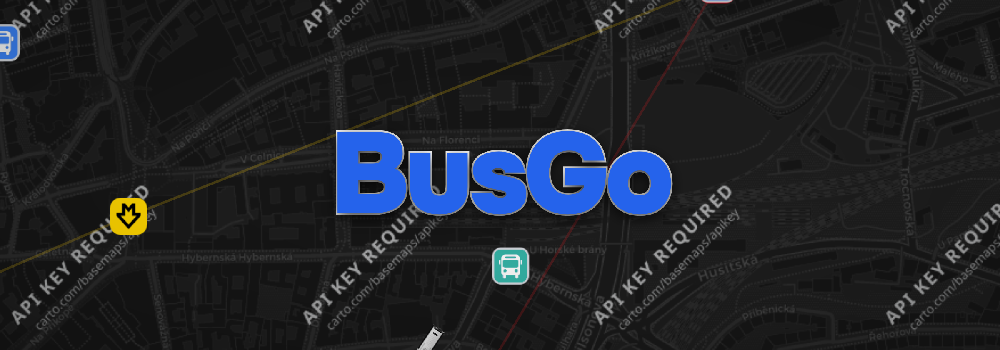

# BusGo

<p align="center">
  
</p>

BusGo is a real-time public transport departure application for Prague, Czech Republic. It combines live PID data with a responsive React interface, an interactive MapLibre map, location-aware stop discovery, and real-time updates through Socket.IO.

## Features

- Real-time departures from the Prague PID/Golemio API
- Interactive map powered by MapLibre GL
- Nearby-stop discovery using device location
- Automatic stop loading as the map moves
- Live delay and departure status information
- Vehicle and route information
- Air-conditioning and accessibility indicators when available
- Favorites for quick access to frequently used stops
- Responsive mobile-first interface
- Progressive Web App support with basic offline caching
- Haptic feedback on supported devices
- Prague timezone handling

## Tech Stack

### Frontend

- React 18
- Vite
- Tailwind CSS
- MapLibre GL
- Socket.IO Client
- Axios
- Framer Motion

### Backend

- Node.js
- Express
- Socket.IO
- Axios
- CORS
- dotenv

### Infrastructure

- Docker
- Docker Compose
- Nginx

## Requirements

For local development:

- Node.js and npm
- A PID/Golemio API key

For containerized deployment:

- Docker
- Docker Compose
- A PID/Golemio API key

You can request an API key from [Golemio](https://api.golemio.cz/).

## Configuration

Copy the example environment file:

```bash
cp .env.example .env
```

Then set your API key in `.env`:

```env
NODE_ENV=production
PORT=3001
TZ=Europe/Prague
PID_API_KEY=your_api_key_here
```

`DOMAIN` can also be configured when needed for deployment.

## Local Development

Install frontend dependencies:

```bash
cd busgo
npm install
```

Install backend dependencies:

```bash
cd ../server
npm install
```

Start the backend:

```bash
npm run dev
```

In another terminal, start the frontend:

```bash
cd busgo
npm run client
```

The frontend is served by Vite during development and the backend listens on port `3001` by default.

## Docker Deployment

Build and start the application:

```bash
docker compose up --build -d
```

Default ports:

- Frontend: `http://localhost`
- Backend: `http://localhost:3001`

Useful commands:

```bash
# Follow logs
docker compose logs -f

# Check service status
docker compose ps

# Restart services
docker compose restart

# Stop services
docker compose down

# Rebuild after changes
docker compose up --build -d
```

## Project Structure

```text
BUSGO/
├── busgo/                  # React + Vite frontend
│   ├── public/             # Public/PWA assets
│   ├── src/                # Frontend source code
│   └── package.json
├── server/                 # Node.js + Socket.IO backend
│   ├── server.js           # Backend entry point
│   └── package.json
├── scripts/                # Project utility scripts
├── Dockerfile              # Main build image
├── Dockerfile.frontend     # Frontend container image
├── Dockerfile.backend      # Backend container image
├── docker-compose.yml      # Local/container orchestration
├── nginx.conf              # Frontend/reverse-proxy configuration
├── .env.example            # Environment variable template
└── README.md
```

## PWA and Updates

BusGo includes service-worker caching and application versioning for installed PWA users.

See [PWA Update & Versioning Guide](./PWA_UPDATE_GUIDE.md) for the current update flow.

## Additional Documentation

- [PWA Update & Versioning Guide](./PWA_UPDATE_GUIDE.md)
- [Haptics](./HAPTICS.md)
- [Koyeb secrets setup](./KOYEB_SECRETS_SETUP.md)

## Security Notes

- Keep `PID_API_KEY` and other secrets in environment variables.
- Do not commit `.env` files containing credentials.
- Route public API access through the backend where possible instead of exposing private credentials to the frontend.

## Contributing

Issues and pull requests are welcome. For changes that affect behavior, include a short explanation of the problem, the approach taken, and how the change was tested.

Before opening a pull request, make sure the frontend builds successfully:

```bash
cd busgo
npm run build
```

## Project Status

BusGo is a working personal project focused on live Prague public transport information. Current development includes map behavior, live vehicle positioning, departure data, PWA versioning, and user-interface refinements.
